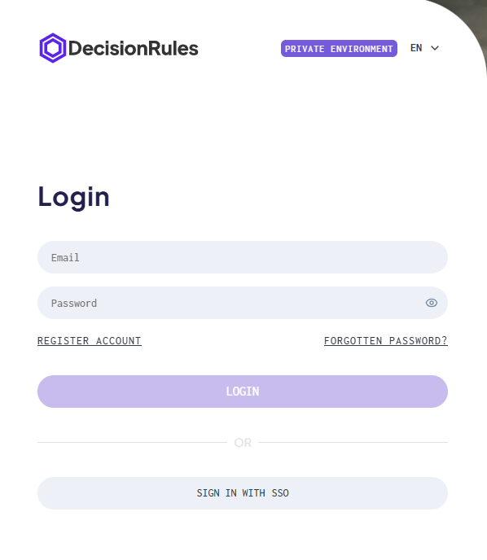

# Login on On Premise

## Login – Accessing Your Account 

Your available sign-in methods depend on your account and the [Environment Settings](https://docs.decisionrules.io/doc/environment/environment-settings).

#### Email and password 

1. Enter your email and password.
2. If 2FA is enabled, enter the current code from your authenticator app and select **Continue**.
3. If the environment requires 2FA and you have not set it up, follow **Set up two-factor authentication** before accessing the application.

See [Two-factor authentication](https://docs.decisionrules.io/doc/profile/two-factor-authentication-2fa) for setup and troubleshooting.


When **Only SSO** is enabled, standard users must use Environment SSO. Environment Managers and License Owners can still sign in with their email and password, subject to the environment's 2FA and email-domain settings.


#### Single Sign-On (SSO) 

Select **Sign in with SSO**. On Docker / On-Premise:

| Configuration                                           | What happens                                                |
| ------------------------------------------------------- | ----------------------------------------------------------- |
| One SSO provider is configured in the application       | You are redirected to that identity provider.               |
| Several SSO providers are configured in the application | The SSO form opens so you can select the intended provider. |

On the SSO form:

* Enter the **SSO Name** provided by your organization administrator to use organization SSO.
* Leave **SSO Name** blank to use environment SSO configured in **Environment → Settings**.

Complete sign-in at your identity provider. DecisionRules then returns you to the application without asking for a separate DecisionRules 2FA code.

If the provider name is incorrect or the selected configuration is unavailable, check the name with your administrator.


Administrators can configure [environment SSO](https://docs.decisionrules.io/doc/environment/environment-settings#configure-environment-sso) or [organization SSO](https://docs.decisionrules.io/doc/organization/settings#single-sign-on-sso).


#### If an image verification appears 

An authentication form may show an image CAPTCHA when additional verification is needed or the usual verification service is unavailable. Enter the characters shown and submit the form again. If a new image appears after an unsuccessful attempt, enter the characters from that image.

Once authentication and any required 2FA are complete, you can access your workspace.

<figure><figcaption></figcaption></figure>
