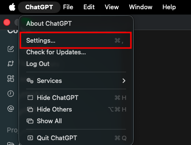
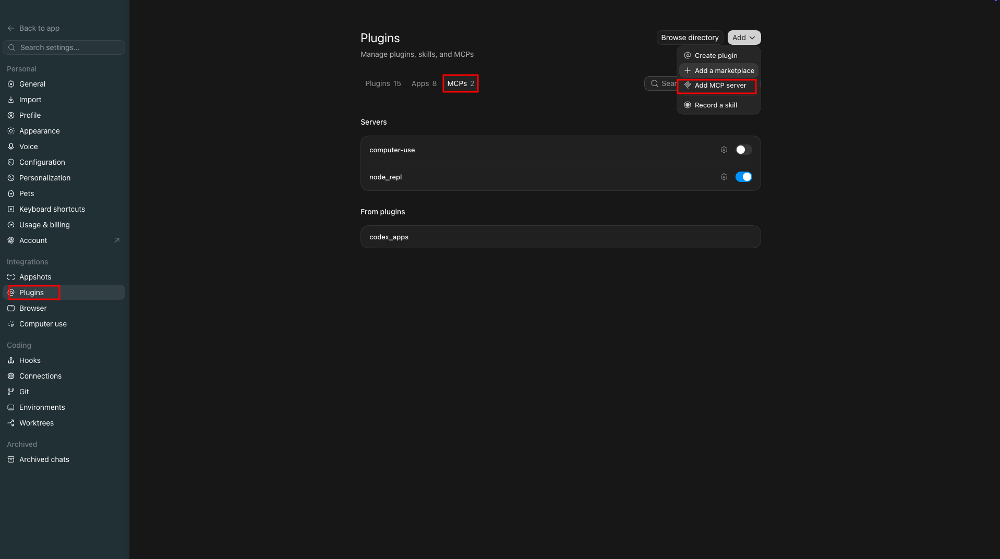
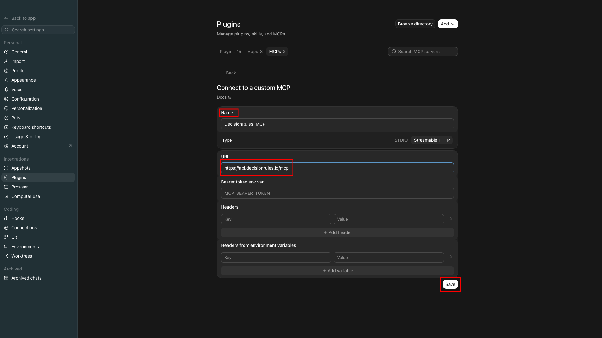
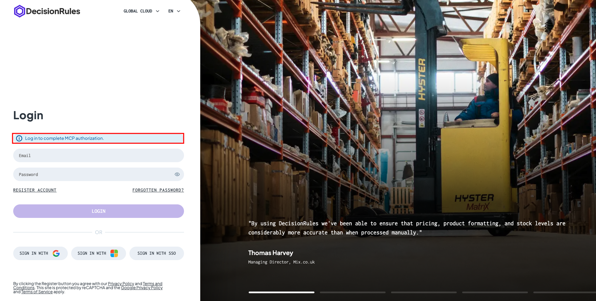
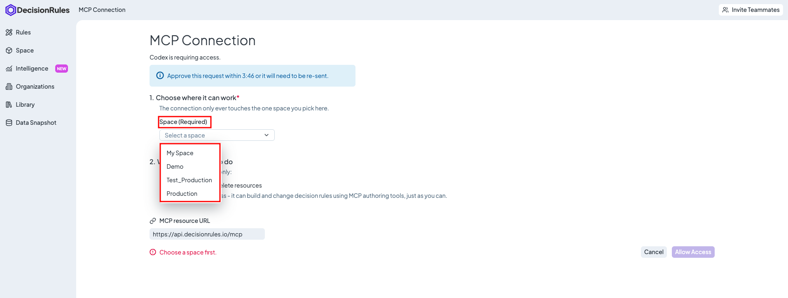
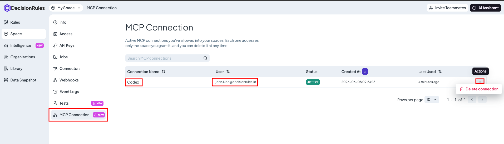

# Authoring MCP Server

## Authoring MCP Server

DecisionRules MCP Authoring Server gives MCP-compatible clients authenticated access to authoring, management, testing, execution, and AI-assisted generation capabilities in one selected DecisionRules space.

Use it when an AI assistant or automation needs to work with rules, Decision Flows, Rule Flows, folders, tags, tests, and related space operations.


**Authoring access.** Grant **Connect MCP Server** only to trusted users. During OAuth approval, the user chooses what the connected client may use in the selected space: Management **Full Access** or **Readonly**, and/or **Solver** (see [Access Scopes](authoring-mcp-server.md#access-scopes)). Within the granted scope, the client's actions are not limited by the connecting user's granular rule permissions or Space Versioning permissions — with Management **Full Access** it can create, change, delete and publish.


### What Can It Do?

Depending on the DecisionRules version and available API keys, an MCP client can:

* Read, create, update, version, lock, organize, and delete rules
* Work with folders, tags, dependencies, Decision Flow resources, and Rule Flow packages
* List, create, update, move, import, and delete tests and test suites
* Solve an existing rule
* Generate Decision Table, Lookup Table, Scripting Rule, and Decision Flow proposals
* Propose a natural-language edit to an existing Decision Table, Scripting Rule, or Decision Flow
* Plan, refine, generate, recover, and import a complete multi-rule process
* Generate test-suite inputs for an exact Decision Table or Scripting Rule version


The focused AI rule, Decision Flow, process, and test-suite tools require DecisionRules App **1.26.2 or later** and AI Engine **1.3.0 or later**.


### Connect to the Authoring MCP Server

#### Prerequisites

Before connecting, make sure that:

* Your MCP client supports remote HTTP MCP servers.
* Your DecisionRules subscription includes Management API and MCP authoring.
* You have access to the space you want to connect.
* Your role has the **Connect MCP Server** permission.
* The space has a Management API key, or your role has **Create API Key** permission so one can be created during OAuth approval.
* The space has a Solver API key if you want to use `solve_rule`, `start_job` or import AI-generated test suites.
* A compatible AI Engine and provider are configured if you want to use AI-assisted tools.

#### Roles and Connection Permissions

The permission to connect an MCP client is separate from the permissions used to view or revoke existing connections.

| Role or access model           | Default behavior                                                                                                                                                   |
| ------------------------------ | ------------------------------------------------------------------------------------------------------------------------------------------------------------------ |
| Private-space Admin            | Can connect MCP clients with any scope, view active connections, change their scope, and revoke them.                                                              |
| Private-space Editor           | Can connect an MCP client with any scope but cannot open the MCP Connections management page.                                                                      |
| Reader                         | Can connect an MCP client with the read-only Management tools and the Solver tools (**MCP Authoring Readonly** and **MCP Solver**), but cannot manage connections. |
| Predefined organization Editor | Has every MCP permission: can connect with any scope, view active connections, change their scope, and revoke them.                                                |
| Custom role                    | Permissions must be added explicitly through the Space Role or policy.                                                                                             |

For organization spaces, being an organization owner or administrator does not automatically grant MCP connection management in every space. The assigned Space Role or policy must include:

* **Connect MCP Server** to authorize and continue using an OAuth connection, and to change a connection's scope
* **View MCP Connections** to open the connection list
* **Delete MCP Connection** to revoke connections
* **MCP Authoring Full Access**, **MCP Authoring Readonly** or **MCP Solver** for the scopes the user may grant — **MCP Authoring Full Access** allows the Management **Full Access** or **Readonly** scope, **MCP Authoring Readonly** only the **Readonly** scope, and **MCP Solver** the **Solver** scope

For OAuth connections, DecisionRules rechecks the user's current **Connect MCP Server** permission and the MCP permission behind each granted scope when later Management and Solver tools are called. Removing **Connect MCP Server** prevents subsequent tool use through that OAuth connection; removing an MCP permission disables the tools of the matching scope.


The current permission check controls whether the OAuth connection can still be used and which scopes stay effective. It does not restrict individual MCP authoring actions to the user's granular rule permissions or Space Versioning permissions.


#### MCP Server URL

Use the URL for your DecisionRules environment:

| Environment       | MCP server URL                        |
| ----------------- | ------------------------------------- |
| Standard cloud    | `https://api.decisionrules.io/mcp`    |
| EU regional cloud | `https://eu.api.decisionrules.io/mcp` |
| US regional cloud | `https://us.api.decisionrules.io/mcp` |
| AU regional cloud | `https://au.api.decisionrules.io/mcp` |
| Self-hosted       | `<YOUR_API_URL>/mcp`                  |

### Connect with OAuth

OAuth is recommended for interactive MCP clients. The following example uses the ChatGPT/Codex app, but the same server can be connected from another remote-HTTP MCP client with OAuth support.



#### Add the Server

Add a remote MCP server in your client and enter the MCP URL for your environment.

<figure><figcaption><p>Add a custom remote MCP server.</p></figcaption></figure>

<figure><figcaption><p>Enter the Authoring MCP server details.</p></figcaption></figure>

<figure><figcaption><p>Save the server configuration.</p></figcaption></figure>



#### Sign In

Select **Authenticate**. The client opens DecisionRules in your browser. Sign in if required.

<figure><figcaption><p>Start OAuth authentication.</p></figcaption></figure>

<figure><figcaption><p>Sign in to DecisionRules when prompted.</p></figcaption></figure>



#### Choose a Space

Select the space the client may access. One connection can access only the selected space.

<figure><figcaption><p>Select the one space the connection may access.</p></figcaption></figure>



#### Choose the Scope and Approve

Under **What it will be able to do**, choose what the client may use:

* **Management** — **No Management access**, **Full Access** (read, create, update, and delete resources with the Management and AI tools) or **Readonly** (only the Management and AI tools that read resources).
* **Solver** — execute rules through the Solver API tools.

Nothing is preselected, and at least one scope is required. You can select only the scopes your role allows and the client requested. Then select **Allow Access**. If the space has no Management API key, approval creates one when you have **Create API Key** permission.



#### Return to the Client

After approval, you are redirected to a successful setup page. The MCP server is now available in the client. Some clients need to be restarted before newly connected tools appear.

The connection is also listed under **Space → MCP Connection** for users with **View MCP Connections** permission.

<figure><figcaption><p>The Authoring MCP server is ready in the client.</p></figcaption></figure>



### Access Scopes

An OAuth connection can use only the tools of the scopes granted during approval:

| Scope                      | Tools                                                                                                                                                                                                                |
| -------------------------- | -------------------------------------------------------------------------------------------------------------------------------------------------------------------------------------------------------------------- |
| Management **Full Access** | All Management tools, including the tools that create, change, delete, import and publish, and all AI-assisted generation and editing tools.                                                                         |
| Management **Readonly**    | Only the tools that read, such as `get_rule`, `get_folder`, `find_nodes`, `list_space_items`, `get_space_info` and `get_test_run_results`, plus `get_process_build`. AI generation and editing need **Full Access**. |
| **Solver**                 | `solve_rule` and `start_job`.                                                                                                                                                                                        |

`execute_tests` works with Management **Full Access** or **Solver**. A tool outside the granted scope is disabled in the client's tool list and refused if called.

To change the scope of an existing connection without reconnecting, use **Edit scope** in [MCP Connections](../../../space/mcp-connections.md). The change applies to every token of that connection. Connections authorized before version 1.28.0 keep Management **Full Access** and **Solver**.

### Connect with a Management API Key

Use a static key for clients that cannot complete OAuth or for controlled service integrations.

1. Open **Space → API Keys**.
2. Create or copy a **Management API** key.
3. Configure the MCP URL and send the key as a Bearer token.

For clients that accept an MCP JSON configuration, use the equivalent of:

```json
{
  "mcpServers": {
    "decisionrules": {
      "url": "https://api.decisionrules.io/mcp",
      "headers": {
        "Authorization": "Bearer <MANAGEMENT_API_KEY>"
      }
    }
  }
}
```


Treat a Management API key as a secret. It provides broad Management API access to its space and is not limited by scopes. A connection using a static key is not listed under **Space → MCP Connection**.


### AI-Assisted Authoring Workflow

AI tools return reviewable proposals. Generation and persistence are separate operations.

#### Create One Rule or Decision Flow

Choose the matching generator:

| Desired proposal | Tool                      |
| ---------------- | ------------------------- |
| Decision Table   | `generate_decision_table` |
| Lookup Table     | `generate_lookup_table`   |
| Scripting Rule   | `generate_scripting_rule` |
| Decision Flow    | `generate_decision_flow`  |

Review a successful result before passing the complete resource unchanged to `import_rule`. Do not import a failed semantic-review result or manually reconstruct its internal payload.

Use Decision Tables as the default for declarative business policy. Use scripting only when the requirement needs a concrete procedural capability that declarative resources cannot provide.

#### Edit an Existing Rule or Decision Flow

Use `propose_rule_edit` with the existing resource identity and the natural-language instruction. The server loads the saved content and chooses the appropriate Decision Table, Scripting Rule, or Decision Flow editor.

After review:

* Use `replace_rule` to update an unpublished version in place.
* Use `import_rule` with `asVersionOf` to preserve the history of a published rule: the proposal is stored as a new version of that rule.

Pass the complete reviewed proposal unchanged. Do not save a corrected copy as a new base rule.

#### Build a Complete Process

A complete process has a reviewable lifecycle:

1. `plan_process` proposes the rules and flows.
2. Review the plan and explicitly choose any existing-rule reuse.
3. Use `refine_process` only when the plan needs a requested change.
4. `start_process_build` starts generation and returns a stable build ID.
5. `get_process_build` reports per-step progress.
6. Use `answer_process_question` or `retry_process_step` when the build reports the corresponding state. For a required split or repair, call `propose_process_step_recovery`, review the localized replacement, and then call `accept_process_step_recovery` after approval.
7. Call `import_process` only after the build is complete and the user approves the import.

Possible existing rules are never selected automatically. Show the candidate's exact alias, version, and status and obtain an explicit choice before adding reuse to the plan.

Generation does not persist rules. `import_process` is the only process-build tool that writes the generated folder to the space.

#### Generate and Import a Test Suite

Use `generate_unsolved_test_suite` for one exact saved Decision Table or Scripting Rule version. It generates test scenarios and inputs, but intentionally leaves expected outputs empty.

After review, pass the proposal unchanged to `solve_and_import_test_suites`. DecisionRules solves the exact saved rule version to populate expected outputs before the suite is persisted.

### Available Tools and Limitations

The exact tools displayed by the MCP client depend on the DecisionRules Server version and on the scopes granted to the connection.


The tool catalogue was renamed in version 1.28.0 — for example `get_latest_rule` and `get_rule_version` became `get_rule`, and `create_rule` became `import_rule`. Reload the tool list in your MCP client after the upgrade and update prompts or scripts that call tools by their old names.


#### Available Capabilities

| Area                     | What the MCP client can do                                                                                                                                                                                                                                     | Example tools                                                                                                                                                    |
| ------------------------ | -------------------------------------------------------------------------------------------------------------------------------------------------------------------------------------------------------------------------------------------------------------- | ---------------------------------------------------------------------------------------------------------------------------------------------------------------- |
| Rules and Decision Flows | Read, create, update, delete, version, lock, and change version status.                                                                                                                                                                                        | `get_rule`, `import_rule`, `replace_rule`, `delete_rule_version`, `set_rule_lock`, `set_rule_version_status`                                                     |
| Folders                  | Read, create, rename, move, import, export, overwrite, and delete folder structures.                                                                                                                                                                           | `get_folder`, `find_nodes`, `move_nodes`, `replace_folder_children`                                                                                              |
| Tags                     | Find items by tags and add or remove tags from resources and versions.                                                                                                                                                                                         | `list_items_by_tags`, `add_tags`, `remove_tags`                                                                                                                  |
| Analysis                 | Read dependencies and find duplicate rows in Decision Tables.                                                                                                                                                                                                  | `get_rule_dependencies`, `find_decision_table_duplicates`                                                                                                        |
| Rule Flows               | Import and export Rule Flow packages and versions.                                                                                                                                                                                                             | `import_legacy_rule_flow`, `export_legacy_rule_flow`                                                                                                             |
| Tests                    | List and manage tests and test suites, including reviewed AI-generated suites, run them and read the results.                                                                                                                                                  | `list_test_suites`, `create_test`, `update_test`, `update_test_suite`, `solve_and_import_test_suites`, `execute_tests`, `get_test_run_results`, `list_test_runs` |
| Space                    | List space items, read the space information and the account usage.                                                                                                                                                                                            | `list_space_items`, `get_space_info`, `get_account_usage`                                                                                                        |
| Solving                  | Execute an existing saved rule with input data, or start an Integration Flow job.                                                                                                                                                                              | `solve_rule`, `start_job`                                                                                                                                        |
| AI rule generation       | Generate Decision Table, Lookup Table, Scripting Rule, and Decision Flow proposals.                                                                                                                                                                            | `generate_decision_table`, `generate_decision_flow`                                                                                                              |
| AI rule editing          | Propose an update to an existing Decision Table, Scripting Rule, or Decision Flow.                                                                                                                                                                             | `propose_rule_edit`                                                                                                                                              |
| AI process authoring     | Plan, refine, build, resume, repair, and import a multi-rule process.                                                                                                                                                                                          | `plan_process`, `start_process_build`, `get_process_build`, `import_process`                                                                                     |
| AI test generation       | Generate inputs for a Decision Table or Scripting Rule test suite.                                                                                                                                                                                             | `generate_unsolved_test_suite`                                                                                                                                   |
| Revisions                | On spaces with [Space Versioning](../../../space/space-version-control/): list revisions, create a draft, request approval, approve, publish and manage revision tags. The tools that read or change rules, folders, tags and tests take `revisionIdentifier`. | `list_revisions`, `create_revision`, `publish_revision`, `set_revision_tag`                                                                                      |

#### Important Limitations

* A connection is limited to one selected space.
* Grant authoring access only to trusted users and clients.
* Delete and overwrite tools can permanently change space resources.
* `solve_rule`, `start_job` and `solve_and_import_test_suites` require a Solver API key.
* AI-assisted tools require a compatible AI Engine, a configured provider, and available AI usage.
* `generate_unsolved_test_suite` supports Decision Tables and Scripting Rules, not Decision Flows.
* A generated Decision Flow is managed through the rule tools. Rule Flow authoring remains limited to the exposed Rule Flow import and export operations.
* Subscription limits, structure limits, validation rules, and endpoint restrictions still apply.
* This server does not search DecisionRules Documentation. Use the separate Documentation MCP server for documentation search.
* On a space with Space Versioning, the tools that read or change rules, folders, tags and tests need `revisionIdentifier` (a tag, `PUBLISHED` or a revision ID); writes are accepted only into a draft. Start with `create_revision` and pass the returned `revisionId` to the following calls. `list_revisions` and `delete_revision_tag` take no revision, `get_space_info` returns counts only when a revision is named, and `solve_rule` and `start_job` use the published revision unless one is named.
* The AI-assisted tools such as `propose_rule_edit`, `generate_unsolved_test_suite` and `import_process` take `revisionIdentifier` as well: generation reads the named revision, and `import_process` and `solve_and_import_test_suites` write only into a draft.
* The connected user's Space Versioning permissions do not apply to MCP tools: a connection with Management **Full Access** can request approval, approve, publish and force-publish. A **Readonly** connection cannot change revisions.

See [Space Version Control — MCP and the AI Assistant](../../../space/space-version-control/api-and-integrations.md#mcp-and-the-ai-assistant) for the revision workflow.


Before allowing an AI client to perform a large or destructive change, ask it to list the planned operations and review the affected resource IDs, paths, aliases, and versions.


### Troubleshooting

| Problem                                                 | Resolution                                                                                                                                                                                   |
| ------------------------------------------------------- | -------------------------------------------------------------------------------------------------------------------------------------------------------------------------------------------- |
| Approval is disabled                                    | Ask for **Connect MCP Server** in the selected space, and choose at least one scope.                                                                                                         |
| An existing OAuth connection stopped working            | Confirm that the user still has **Connect MCP Server** and that the connection has not been revoked.                                                                                         |
| A tool is disabled or refused because of its scope      | The connection's scope does not include the tool, or the user no longer has the matching MCP permission. Change the scope with **Edit scope** in MCP Connections, or ask for the permission. |
| A Management API key cannot be created                  | Create the key first, or ask for **Create API Key** permission.                                                                                                                              |
| MCP tools are unavailable                               | Confirm that the subscription includes Management API and MCP authoring, then reconnect or refresh the client.                                                                               |
| A tool named in a prompt or script is not found         | The tool catalogue was renamed in version 1.28.0. Reload the client's tool list and use the current tool names.                                                                              |
| AI authoring tools fail or are missing                  | Confirm App and AI Engine compatibility, `AI_ENGINE_URL`, provider configuration, and AI usage availability.                                                                                 |
| `solve_rule` or test-suite import reports a missing key | Create a Solver API key in the selected space.                                                                                                                                               |
| A process is still running                              | Continue polling its existing build ID. Do not start the same build again.                                                                                                                   |
| The connection request expired                          | Start a new connection from the MCP client.                                                                                                                                                  |
