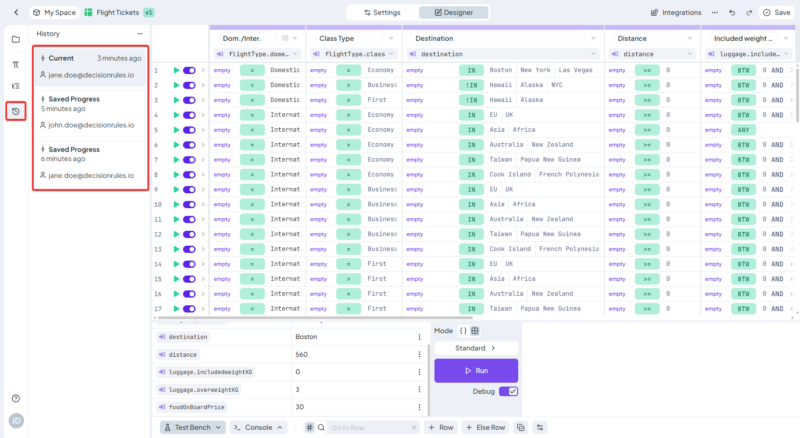
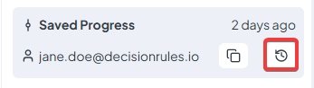
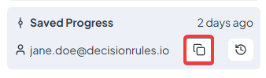

# Rule History


The **Rule History** feature is not available for **Rule Flow**. You can edit and save a Rule Flow as usual, but its previous versions are not stored or displayed in a history panel.


The **History** panel provides an overview of the saved versions of a rule.\
Each time you click **Save** in the editor, a new entry is recorded here. This allows you to track when and by whom each change was made, and to revisit a previous version when needed.


The number of saves kept for each rule version depends on your plan. When the limit is reached, the oldest saves are removed. See [Plan Limits Explained](../../profile/limits/plan-limits-explained.md).


#### Overview

The **History** panel is located on the left side of the rule editor. It shows the saves of the rule as a graph, newest first.\
Each entry shows:

* **Timestamp** – when the rule was saved.
* **Author** – the avatar of the user who saved the rule. Hover over it to see the user's name and email. A save made through the Management API shows the API key's name and its masked value instead.
* **Space Versioning enabled** – a badge on the entry recorded when Space Versioning was enabled for the space. Its avatar shows who enabled it.

<figure><figcaption></figcaption></figure>


On a space with [Space Versioning](../../space/space-version-control/) the graph draws one lane per revision; hover over an entry's dot to see the revisions it belongs to. The **Current Revision** switch limits the graph to the saves of the revision you have switched to. **Restore version** writes the save into a draft revision: if you are not working in a draft, you are first asked to switch to one or to fork the current revision. See [Working in a Revision](../../space/space-version-control/working-in-a-revision.md#rule-history).


#### Viewing previous versions

Click any entry in the graph to open that historical version directly in the rule Designer.\
When selected, the editor will display that version of the rule, allowing you to review its exact configuration at the time of saving.\
To return to your working copy, select the newest entry again.

#### Editing and evaluation rules

Only the current version of a rule is editable and can be executed (tested or run).\
Historical versions are displayed in **read-only mode** — you can view them but not modify or evaluate them.

Every entry except the newest one has a **…** menu with these actions:

* **Compare with current** – opens a side-by-side comparison of the selected save with the current version of the rule.
* **Restore version** – replaces the current version with the selected historical one. The restored version becomes the new current version and can be edited and evaluated as usual. The previously current version stays in the history, ensuring that no data is lost.

<figure><figcaption></figcaption></figure>

* **Clone version** – creates a completely new rule based on the selected historical version. The new rule opens immediately in the editor and behaves like any other newly created rule.

<figure><figcaption></figcaption></figure>


Don't forget to change the alias after cloning.


#### How it relates to editing

The **History** panel records only _saved_ versions of a rule.\
Actions performed using **Undo** and **Redo** affect the current unsaved state of the rule and are not stored here until you save the rule again.
