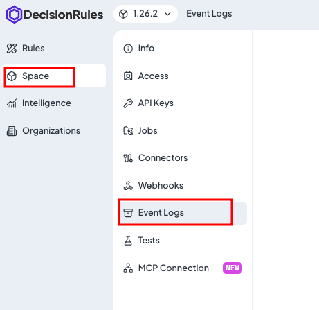
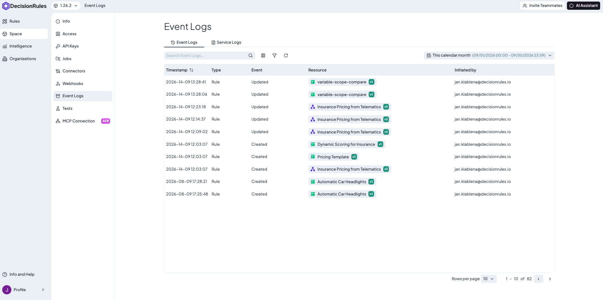
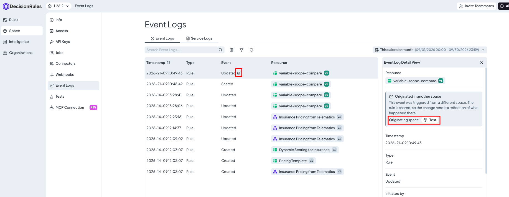
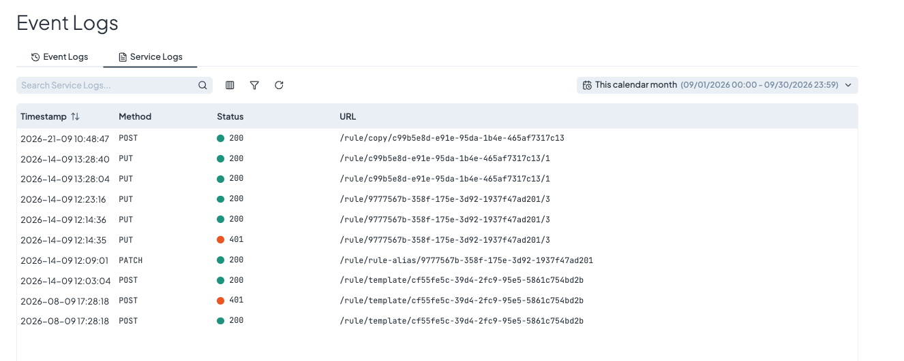
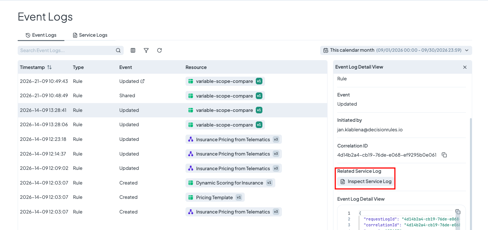

# Event Logs, Service Logs and Notifications

_Event Logs_ show what happened to your rules — created, updated, deleted, shared. _Service Logs_ show every API call made to your space. _Webhooks_ notify external systems when events happen.

The three work together: an API call produces a Service Log entry and one or more Event Log entries, and webhooks subscribed to those events fire as the changes are recorded.



#### Finding the Event Logs Menu

All audit data for a space is available in the _Event Logs_ menu accessible from the Homepage via Space -> Event Logs.

<figure><figcaption>
Location of the Event Logs menu
</figcaption></figure>

The menu has two tabs: _Event Logs_ (changes in your space) and _Service Logs_ (API calls). Both tabs share the same toolbar — search box, filters, column switch, date range, and pagination controls.

### Event Logs

Each row in Event Logs records one change — to a rule, to an API key, or on a versioned space to a revision. You'll see when it happened, the type of resource, what kind of change, which resource was affected, and who made the change.

<figure><figcaption>
Overview of Event Logs
</figcaption></figure>

#### Event types

The events recorded for rules are:

* **Created**
  * A new rule was created
* **Updated**
  * An existing rule was modified
* **Deleted**
  * A rule was deleted. On a space with Space Versioning the rule can still be restored from the revision's Recycle Bin.
* **Shared**
  * A rule was shared into another space
* **Unshared**
  * A rule was removed from a space it was shared into
* **Published** / **Unpublished**
  * The status of a rule version was changed to published or pending

Changes to API keys are recorded too: **Created**, **Updated** (renamed) and **Deleted**. These rows have the type **API Key** and show the key's name as the resource.

On a space with [Space Versioning](space-version-control/), every rule event also records the **revision** the change was made in, and the lifecycle of revisions is logged as its own events — created (a fork included), updated (renamed or description changed), approval requested, changes requested, approved, published (a rollback included), archived, deleted — together with revision tag changes (created, moved, updated, deleted) and versioning being enabled or disabled. The list then has a **Revision** column. Use the **Revision** filter to see what happened in one revision.

#### Initiated by

The _Initiated by_ column shows who made the change:

* **Avatar with initials** — the change was made by a user signed in to the web app. Click the avatar to see the user's name and email.
* **API key name** — the change was made by an integration using an API key. The column shows the key's name, or **Management API Key** when the name is not available to you. The row's detail view adds the masked API key.

If your role does not include **View Users**, changes made by other users are shown as **Hidden user**.


For security, only a truncated form of the API key appears in audit data. The full key value never leaves the backend, even in audit logs.


#### Cross-space events

When a rule is shared between spaces, changes to that rule affect every space that has access to it. A small ↗ icon next to the action indicates a cross-space event — meaning the change was made from a different space.

Open the row's detail drawer to see which space the change originated from.

<figure><figcaption>
Event Log - Rule Updated performed in a different Space
</figcaption></figure>

### Service Logs

Each row in Service Logs records one API call to your space. You'll see when the call happened, the HTTP method, the response status code, the URL path, and who initiated the call.

<figure><figcaption>
Review API calls made to your Space, including their method, status, and endpoint.
</figcaption></figure>

Failed authentication attempts are also recorded — useful for spotting unexpected access patterns.

#### Status code groups

Status codes are grouped into colored bands:

* <mark style="color:$success;">2xx</mark> — successful requests
* <mark style="color:orange;">4xx</mark> — client errors (bad requests, unauthorized, not found)
* <mark style="color:red;">5xx</mark> — server errors

#### Request body

Each Service Log entry captures the body sent with the request. Large fields are truncated to keep storage manageable: nested objects are collapsed to `[object]`, arrays that contain objects are collapsed to `[array]`, and strings longer than 1KB are cut with a `…[truncated]` marker.

This means you can see _what_ was sent without storing megabytes of decision-table data on every request.

### How Event Logs and Service Logs Connect

Every Event Log entry has a parent Service Log. One Service Log can have many child Events.

Why? One API call can change many things. Deleting a folder with five rules is one DELETE request (one Service Log row) that produces five Deleted events (five Event Log rows). All of them share the same _correlation ID_.

You can navigate between the two views:

* From an Event or Service Log entry, click **Inspect Service Log / Inspect Event Log(s)** to jump to the API call that produced it

<figure><figcaption>
Inspect the parent Service Log directly from an Event Log entry.
</figcaption></figure>


For cross-space events, the related Service Log lives in the originating space — you can see the event itself but not navigate to its API call from a receiving space.


### Correlation IDs

A correlation ID is a unique identifier shared by every record produced by one API call. Use it to:

* Search either tab to find every record related to one operation
* Trace requests across systems — pass your own correlation ID by sending an `x-correlation-id` HTTP header on your API call, and the same value will appear in both Event Logs and Service Logs

When you provide your own correlation ID, the API response includes it back in the `x-correlation-id` response header so your integration can capture it.

### Filtering and Searching

The toolbar above each list supports:

* **Search** — matches against rule names, user emails, API keys, URL paths, and rule IDs (depending on which tab you're in)
* **Filters** — in Event Logs by event type, resource type, resource (one rule), revision (on a space with Space Versioning) and correlation ID; in Service Logs by HTTP method, HTTP status and correlation ID
* **Toggle columns** — show or hide columns of the list
* **Date range** — defaults to the current calendar month; change it to whatever window you need

All filters combine and can be cleared with one click.

#### Pagination

Results are paginated. Use the page-size selector to switch between 10, 20, 50 and 100 rows per page, and the arrows to move forward and backward. The "x of y" counter shows your position; counts above 10,000 display as "10,000+".

### Data Retention

Audit data is retained for 90 days. After that, both Event Logs and Service Logs entries are automatically deleted. The retention window applies equally to both, so an Event and its parent Service Log expire together.

### Webhooks

Webhooks notify external systems when events happen in your space. They're configured per space and fire as events are recorded.


Webhooks are configured separately in the _Webhooks_ menu. See [Webhooks](webhooks.md) for full setup details.


#### Subscribing to events

When you create a webhook, you choose which events to subscribe to. Events are grouped by resource type:

* **Rule events** — Created, Updated, Deleted, Shared, Unshared, Published, Unpublished
* **Job events** — Completed, Canceled, Error
* **Revision events** — Versioning Enabled / Disabled, Revision Created, Updated, Approval Requested, Changes Requested, Approved, Published, Archived, Deleted, Tag Created, Tag Moved, Tag Updated, Tag Deleted (event types `REVISION.*`). They are offered on every space but fire only on spaces with [Space Versioning](space-version-control/); Versioning Enabled fires when it is switched on. See [Webhooks and Event Logs](space-version-control/api-and-integrations.md#webhooks-and-event-logs).
* **API Key events** — API Key Created, Updated, Deleted (event types `API_KEY.*`)

For rule events specifically, you can also filter by rule status:

* **Published only** — only fire for changes to published rules
* **Pending only** — only fire for changes to pending rules
* **Both** — fire for any rule status change

Leaving both checkboxes ticked is the default and gives you all rule events.

<figure><figcaption>
Configure a webhook endpoint to receive notifications when rule actions occur.
</figcaption></figure>

#### Webhook delivery

Each webhook POST includes signed headers your endpoint can use to verify authenticity:

* `X-Webhook-Signature` — HMAC-SHA256 of the payload, signed with your webhook secret
* `X-Webhook-Timestamp` — when DecisionRules sent the notification
* `X-Webhook-Delivery-Attempt` — which retry attempt this is (0 = first try)

If delivery fails (timeout, 5xx response, or rate limiting), DecisionRules retries up to 3 times with exponential backoff (1s, 2s, 4s). Other 4xx responses are not retried — they indicate a permanent problem with the request shape and retrying won't help.

Webhook delivery is fire-and-forget: a slow or failing webhook never delays the original API call's response to the user.

#### Payload shape

Each webhook POST includes:

* `eventType` — the combined event identifier (e.g. `RULE.UPDATED`)
* `entityType` and `action` — the same information split into separate fields
* `data` — the resource-specific payload
* `metadata.timestamp` — when the notification was sent
* `metadata.spaceId` — the space the event belongs to
* `metadata.correlationId` — for cross-system tracing
* `metadata.requestLogId` — references the parent Service Log entry
* `metadata.auth` — who made the change: the user, or the masked API key
* `data.revisionId` and `data.revisionName` — on a versioned space, the revision a rule event was made in, the revision a revision event is about, or the revision a job ran against (`REVISION.PUBLISHED` also carries `data.publishPath`: `REVIEW`, `DIRECT`, `FORCE` or `ROLLBACK`)

Rule Shared and Rule Unshared events also carry `data.sourceScopeId` and `data.targetScopeId`, the two spaces involved.

#### When a webhook will not fire

A subscribed webhook will not fire if:

* The webhook is inactive (toggle off)
* The event type is not in the webhook's subscription list
* The rule-status filter excludes the event (rule events only)
* The underlying database write failed — DecisionRules will not notify about something that wasn't actually recorded
