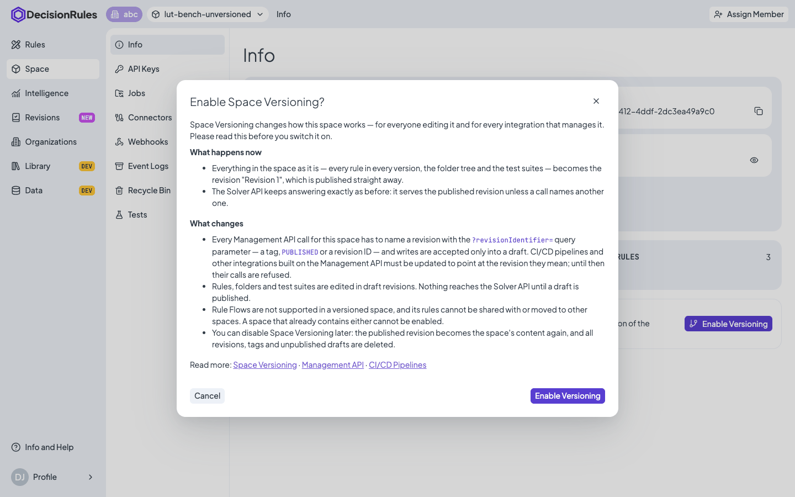

# Space Version Control

Space Version Control — **Space Versioning** in the application — lets a team change the rules of a space the way software teams change code: work happens in a _draft revision_, the draft is reviewed and approved, and only _publishing_ it makes the change live for the Solver API. Every revision that was ever published stays in the history, can be compared with any other, can be called from the API by name, and can be brought back with one click.


Space Versioning is available from version **1.28.0** for spaces that belong to an **organization**. In the cloud it is an add-on: it is included in the trial, and our sales team can add it to your account — while your account does not have it, the **Revisions** section shows how to request it. Self-hosted deployments need a licence that includes it and a MongoDB replica set — see [Self-Hosted Requirements](self-hosted-requirements.md).


### Why Use It?

* Edit safely — nothing reaches production until a draft is published.
* Send changes for review and have them approved before they go live.
* Roll back to any previously published revision in one click.
* Point tags such as `production` or `staging` at a revision and let each integration call exactly the revision it expects.
* See who changed what, compare revisions rule by rule, and keep the full history of the space.

### Core Concepts

* **Revision** — a complete, consistent snapshot of the space: every version of every rule, the folder tree and the test suites. A revision is created as a copy of another revision and then changed in place while it is a draft.
* **Draft** — a revision that accepts changes. A space can have several drafts open at once, for example one per feature or per team.
* **Published revision** — the one revision that is live. Solver API calls that do not name a revision are answered from it. Exactly one revision is published at a time; publishing a new one archives the previous one.
* **Revision tag** — a movable name for a revision (`production`, `staging`, `v2`). Integrations call a tag instead of a revision ID, so a tag can be moved to a new revision without changing any URL. The built-in tag `PUBLISHED` always names the published revision.
* **Revision identifier** — what API calls send in the `?revisionIdentifier=` query parameter: a tag name, `PUBLISHED`, or a revision ID.


Space Versioning is different from [rule versions](../../rules/common-rule-features/versioning.md). Rule versions (1, 2, 3, …) still exist inside every revision and still have their own published/pending status. A revision is a snapshot of the whole space, including all those rule versions.


### How It Works

A revision moves through these states:

* <mark style="color:$info;">Draft</mark> — being edited. Rules, folders and test suites can be changed. Solver calls can target a draft by name, so it can be tested before it goes anywhere.
* <mark style="color:$warning;">Awaiting approval</mark> — approval was requested. The content is frozen; reviewers approve it or request changes, which returns it to Draft.
* <mark style="color:$success;">Approved</mark> — approved and ready to be published. Still frozen.
* <mark style="color:purple;">Published</mark> — live. This is what the Solver API serves by default.
* Archived — a revision that was published before and has been replaced, or an open revision that was closed without publishing. Archived revisions stay readable, comparable and callable by name.

Everything a user does in the UI happens in the revision they have _checked out_: the revision picker in the top bar shows which one that is, and a versioned space always has exactly one checked out. Read the details in [Revisions](revisions.md) and [Working in a Revision](working-in-a-revision.md).

### Enabling Space Versioning

#### New spaces

A space created inside an organization whose account has Space Versioning — the trial or the add-on in the cloud, the licence when self-hosted — is versioned from the moment it is created: it starts with an empty, published _Revision 1_. Nothing has to be switched on.

#### Existing spaces

1. Open the space and go to **Space → Settings**, tab **Revision Settings**. The tab is shown on spaces that belong to an organization; the **Space Versioning** card shows whether versioning is **Enabled** or **Disabled**. The **Revision Settings** button on **Space → Info** leads there too. While the space is not versioned, the **Revisions** section in the left menu offers **Enable Versioning** as well.
2. Click **Enable Versioning**. In **Revision Settings** the button is shown only to users with the **Change Versioning Settings** permission; in the **Revisions** section users without it see the button disabled with _"You need the permission to change the versioning setting."_
3. Read the confirmation. It summarizes what happens now and what changes for everyone who edits the space or integrates with it, and links to the documentation.
4. Click **Enable Versioning** in the confirmation.

<figure><figcaption>
The confirmation shown before Space Versioning is enabled
</figcaption></figure>

What happens when you enable it:

* Everything in the space as it is — every rule in every version, the folder tree and the test suites — becomes **Revision 1**, which is published immediately. The revision is stamped with the user who enabled versioning.
* The Solver API keeps answering exactly as before: it serves the published revision unless a call names another one.
* The UI checks out Revision 1 for you. The rule list, folders and tests look exactly as they did a moment ago.
* The **Revisions** section now lists Revision 1, and the revision picker appears in the top bar.

A space cannot be enabled while any of the following is true:

| Condition                                                                           | What you see                                                                                                                                                                                                                                                                                                                                                                                                                                                                                                                                                           |
| ----------------------------------------------------------------------------------- | ---------------------------------------------------------------------------------------------------------------------------------------------------------------------------------------------------------------------------------------------------------------------------------------------------------------------------------------------------------------------------------------------------------------------------------------------------------------------------------------------------------------------------------------------------------------------- |
| The space does not belong to an organization                                        | There is no **Revision Settings** tab, and **Space → Info** says "Space Versioning is available only on organization-owned spaces." The API refuses the request with "Space versioning can only be enabled on organization-owned spaces."                                                                                                                                                                                                                                                                                                                              |
| The space contains a Rule Flow, or a rule of the space is shared with another space | The confirmation reopens as **Space Versioning cannot be enabled yet** and lists the blocking rules under **Rule Flows** ("Convert each Rule Flow to a Decision Flow and delete the original, or delete it.") and **Shared with other spaces** ("Remove the share, or keep the rule in one space only."). The API answers HTTP 400 with `error.code` `VERSIONING_ENABLE_BLOCKED`, the rules in `error.blockingRules`, and a message such as "Cannot enable Space Versioning. Rules shared with other spaces: … Rule flows: … Then retry." (up to 10 names per reason). |
| The account (or, self-hosted, the licence) does not include Space Versioning        | In **Revision Settings** the button is disabled with "Space Versioning is not available on your current plan." The **Revisions** section shows "Space Versioning is not part of your plan": the space owner gets **Contact Sales**, other members are asked to contact the owner, and a self-hosted deployment is told that its licence does not include it yet. The API answers HTTP 426.                                                                                                                                                                             |
| Self-hosted: MongoDB runs without transactions                                      | "Space Versioning requires MongoDB transaction support…" — see [Self-Hosted Requirements](self-hosted-requirements.md).                                                                                                                                                                                                                                                                                                                                                                                                                                                |

### What Changes Once It Is Enabled

* **Editing happens in drafts.** Saving a rule, folder or test while you are on a revision that is not a draft — published, archived, awaiting approval or approved — opens a prompt to switch to a draft or to create one. See [Working in a Revision](working-in-a-revision.md).
* **The Solver API does not change.** Calls without a revision keep getting the published revision. Add `?revisionIdentifier=<tag or revision ID>` to solve against another one — for example a draft that is being tested.
* **The Management API requires a revision.** Every call to `/api/...` for a versioned space has to say which revision it reads or writes, with the same `?revisionIdentifier=` parameter, and writes are accepted only into drafts. CI/CD pipelines and other integrations built on the Management API must be updated before they keep working. See [API and Integrations](api-and-integrations.md).
* **Rule Flows and cross-space sharing are not available** in a versioned space. See [Limits, Limitations and Disabling](limits-limitations-and-disabling.md).
* **New permissions** control who may request approval of a draft, approve, publish and manage revisions. See [Roles and Permissions](roles-and-permissions.md).
* **Webhooks** can notify you about every step of the revision lifecycle, and rule events say which revision they happened in.


Space Versioning can be disabled again, but disabling deletes all revisions, tags, comments and unpublished drafts. The published revision becomes the ordinary content of the space. See [Limits, Limitations and Disabling](limits-limitations-and-disabling.md#disabling-space-versioning).


### Quick Start



#### Create a draft

Open the revision picker in the top bar and choose **Fork Current Revision**, or simply save a change — the UI asks you to name a new draft when none exists. Give the draft a name such as _Q3 pricing update_.



#### Make and test your changes

With the draft checked out, edit rules, folders and tests as usual. Run the Test Bench or the test suites: they run against the draft. To test from outside, call the Solver API with `?revisionIdentifier=<draft ID>`.



#### Request approval

Open the draft in the **Revisions** section and click **Request Approval**. The draft becomes read-only. A reviewer with the **Approve / Reject** permission opens it, reviews the changes — **Compare with** starts at the revision the draft was forked from — and either approves it or requests changes with a comment.



#### Publish

A user with the **Publish** permission clicks **Publish** on the approved revision. It is live immediately; the previous published revision is archived. Every Solver API call without a revision now gets the new content.



#### Give integrations a stable name

Create a tag such as `production` on **Space → Settings**, tab **Revision Settings**, and point your integrations at `?revisionIdentifier=production`. When the next revision is ready, move the tag — no integration has to change.



Read more:


[revisions.md](revisions.md)



[working-in-a-revision.md](working-in-a-revision.md)



[revision-tags.md](revision-tags.md)



[roles-and-permissions.md](roles-and-permissions.md)



[api-and-integrations.md](api-and-integrations.md)



[self-hosted-requirements.md](self-hosted-requirements.md)



[limits-limitations-and-disabling.md](limits-limitations-and-disabling.md)

