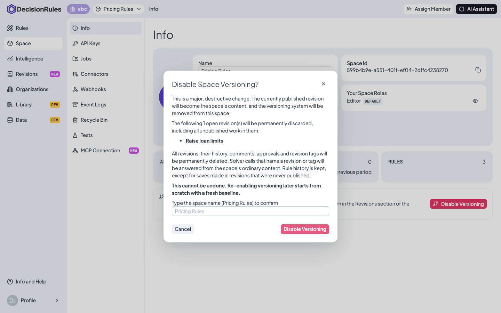

# Limits, Limitations and Disabling

### Plan Limits

* **Space Versioning** — whether your account has the feature. In the cloud it is an add-on: it is included in the trial, and our sales team can add it to your account — use **Contact Sales** in the **Revisions** section of a space. On self-hosted deployments the licence must include it. It is checked when versioning is enabled and whenever a revision is created (fork, new draft, rollback). Without it the request is refused with HTTP 426: _"Space Versioning is not available on your current plan."_ A space that is already versioned keeps working if the account later loses the feature, but no new revisions can be created on it.
* **Revisions per account** — the number of revisions an account may keep, counted across all spaces the account owns and in every state, archived and published ones included. The trial includes 15. When the limit is reached, creating a draft or forking a revision is refused with HTTP 426: _"Revision limit reached (n/max). Delete an old revision in one of the account's spaces or upgrade your plan."_ Delete archived revisions you no longer need to free capacity. A rollback is not limited by this number; it only needs the Space Versioning feature.
* **Rules and tests** — the rule and test limits of your plan apply to each revision on its own: drafts are not added up. A rule or test created in a draft is checked against that draft. Your account's usage counts each versioned space with its largest revision, archived revisions included, so deleting old revisions can lower it. Bringing a draft up to date with the published revision — **Update Revision**, **Request Approval** or **Publish without Review** of an outdated draft, **Resolve Conflicts**, and their API equivalents — is refused with HTTP 426 when the result would exceed a limit, and nothing is written: _"After catching up with the published revision, this revision would count N rules against your plan's limit of M. Delete some of them in the revision, then retry."_ Publishing, approving, force publishing, rolling back and forking do not check the rule and test limits.
* **Rule History** — the number of saves kept per rule version. On a versioned space, every save that a revision refers to is kept regardless of this limit; the limit applies to the older saves nobody refers to any more.

These HTTP 426 messages end with _"Please upgrade your plan or contact our support (support@decisionrules.io)."_

**Account Limits** in your profile shows the Space Versioning limit as one row, **Space Versioning revisions**: the number of revisions your account may keep, when the feature is included. The Rule History limit is not listed there — see [Plan Limits Explained](../../profile/limits/plan-limits-explained.md). On self-hosted deployments the licence sets the limits.

### Limitations

* **Organization spaces only.** Private spaces cannot be versioned. Move a private space into an organization first ([Spaces Migration](../space-info/space-migration.md)).
* **No Rule Flows.** A versioned space refuses to create or import a Rule Flow: _"Rule flows are not supported in a space with Space Versioning enabled — rule flows are not versioned. Create or import it in a space without versioning, or disable Space Versioning on this space."_ (error code `RULE_FLOW_IN_VERSIONED_SPACE`). A space that already contains a Rule Flow cannot be enabled; the enable dialog lists the Rule Flows to convert to Decision Flows or delete. Decision Flows and Integration Flows are fully supported.
* **No cross-space sharing.** Rules cannot be shared with, moved into or moved out of a versioned space — a versioned space owns its rules exclusively: _"Rules cannot be shared into or out of a space with Space Versioning enabled — a versioned space owns its rules exclusively."_ Removing a shared rule from a versioned space is refused as well: _"Rules cannot be removed from a space with Space Versioning enabled — delete the rule in a draft revision instead."_ A space with shared rules cannot be enabled until the shares are removed; the enable dialog lists them. Use export and import to copy rules between spaces.
* **The Management API always needs a revision** — see [API and Integrations](api-and-integrations.md).
* **The Kafka Solver API** evaluates the published revision only.
* **AI Assistant and MCP** work in the checked-out or the named revision — see what still differs in [API and Integrations](api-and-integrations.md#mcp-and-the-ai-assistant).
* **Self-hosted on Azure Cosmos DB for MongoDB (RU)** — Space Versioning is not supported; see [Self-Hosted Requirements](self-hosted-requirements.md).
* Comments are limited to 100 per revision and 2000 characters each; a revision name to 120 characters and a summary to 2000.

### Disabling Space Versioning

Disabling turns the space back into an ordinary space whose content is the currently published revision.

1. Go to **Space → Settings**, tab **Revision Settings**, and click **Disable Versioning**. The **Revision Settings** button on the **Space → Info** card leads there too. The button is shown only to users with the **Change Versioning Settings** permission.
2. Read the confirmation. It lists the open revisions that will be discarded and explains what is deleted.
3. Type the name of the space to confirm and click **Disable Versioning**.

<figure><figcaption></figcaption></figure>

What happens:

* The published revision's rules, folder tree and test suites become the space's content. Anyone working in the space sees exactly what the Solver API was serving.
* **All revisions are deleted** — drafts, revisions awaiting approval, approved and archived ones — together with their comments, activity and approvals. Unpublished work in open revisions is lost.
* **All revision tags are deleted.** Solver calls that still send `?revisionIdentifier=` are not refused: the parameter is ignored on a space without versioning and the call is answered from the space's content. Management API calls no longer need it.
* **Rule history is kept**, except for the saves that were made only in revisions that were never published; those disappear with the drafts.
* The **Versioning Disabled** webhook event fires, the revision picker and the **Recycle Bin** menu item disappear, the tag list leaves **Revision Settings**, and the **Revisions** section shows its placeholder again.


Disabling cannot be undone. Re-enabling Space Versioning later starts from scratch with a fresh Revision 1 — the previous revisions are not restored.

