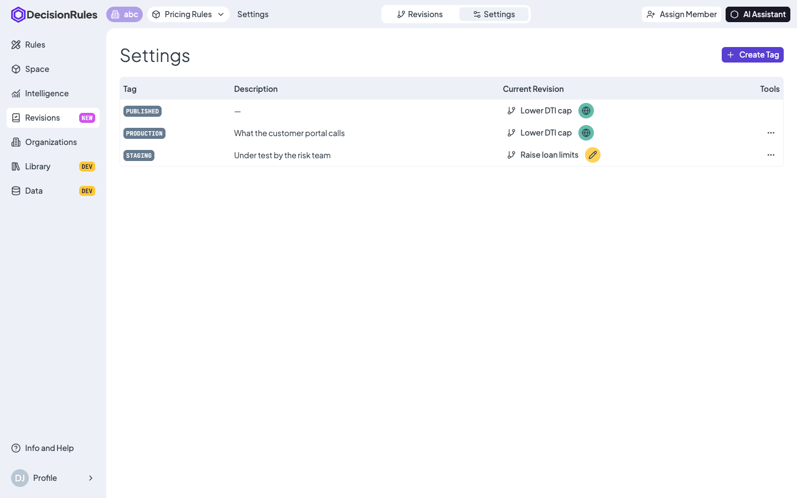

# Revision Tags

A revision tag is a movable name for a revision. Integrations call a tag — `?revisionIdentifier=production` — instead of a revision ID, so you can point them at a new revision by moving the tag, without changing a single URL.

### The Built-in Tag

Every versioned space has the tag **PUBLISHED**. It always names the revision that is currently published, moves with every publish and rollback, and cannot be edited or deleted. `?revisionIdentifier=PUBLISHED` is the same as sending no revision at all on the Solver API; on the Management API it is the way to read the live content. Like every tag name it is case-sensitive: write it in capitals, `published` is refused as an unknown revision.

### Managing Tags

Tags are managed on **Space → Settings**, tab **Revision Settings**. The tab is shown on every organization space and holds the Space Versioning switch; once the space is versioned, it also lists every tag with its description and the revision it currently points at, the built-in **PUBLISHED** tag first.

<figure><figcaption></figcaption></figure>

* **Create Tag** opens a dialog with the tag **Name**, an optional **Description**, a **Color** and the **Current Revision** the tag points at. A revision in any state can be tagged. A name that is already taken is refused: _"A tag named … already exists. Edit that tag to move it to another revision."_ (Through the API, `PUT /api/revision/tag/{name}` creates the tag or moves the existing one.)
* **Edit Tag** (in the row's tools menu) changes the name, description, colour or the revision.
* **Delete Tag** removes the tag. The revision is not affected. The confirmation warns that _"Integrations calling it by name will stop resolving and receive an error."_
* A tag can also be moved from the **Revisions** list: **Tools → Tag Revision** shows the space's own tags (never **PUBLISHED**; _No tags yet_ when there is none) — pick one to move it to that revision. The **Move Tag** dialog shows the tag with its **Source Revision** and **Target Revision** and explains that _"Any integration calling the tag will now resolve to the new revision."_

Creating, editing, moving and deleting tags needs the **Manage Revisions** permission. Without it the tab is read-only: there is no **Create Tag** button or row menu, and **Tag Revision** is not offered in the Revisions list. Every change takes effect on the next API call.

Tag names follow these rules:

* 1 to 64 characters — letters, digits, dashes and underscores. Names are case-sensitive: `Prod` and `prod` are two different tags.
* Unique within the space.
* `PUBLISHED` is reserved in any letter case, so `published` or `Published` cannot be created either.
* A name must not have the shape of a revision ID, because `revisionIdentifier` is resolved as a tag first and as a revision ID second.

### How Tags Behave in the Lifecycle

* **Publishing** a revision does not move your tags. Move `production` to the new revision when you decide it is ready — that is the point of a tag.
* **Archiving** a revision keeps its tags; the tagged content is still served.
* A revision **cannot be deleted** while a tag points at it. Move or delete the tag first.
* **Disabling** Space Versioning deletes all tags. Integrations that keep sending `?revisionIdentifier=` afterwards are not refused: on a space without versioning the parameter is ignored.

### Using Tags

* **Solver API:** `POST https://api.decisionrules.io/rule/solve/{ruleId}?revisionIdentifier=production`
* **Management API:** every call names the revision it works with, for example `GET https://api.decisionrules.io/api/rule/{ruleId}?revisionIdentifier=production` reads the rule as it is in the revision the tag points at.
* **Jobs and test runs** started through the API accept the same parameter.

Typical patterns:

* **Staged rollout.** `staging` points at the revision under test, `production` at the one customers use. Publish, test `staging`, then move `production`.
* **Pinning a consumer.** Point `partner-x` at the revision a partner integrated against and move it only after they confirmed the new one.
* **Fast rollback for one consumer.** Move a tag back to the previous revision; no other consumer is affected. To roll back the space itself, use **Roll back to this version** in the [Revisions](revisions.md#rolling-back) list.

The **Tag Created**, **Tag Moved**, **Tag Updated** and **Tag Deleted** webhook events report every change — see [API and Integrations](api-and-integrations.md#webhooks-and-event-logs). A save that changes nothing sends no event; an edit that renames a tag and points it at another revision sends **Tag Updated** and then **Tag Moved**.
