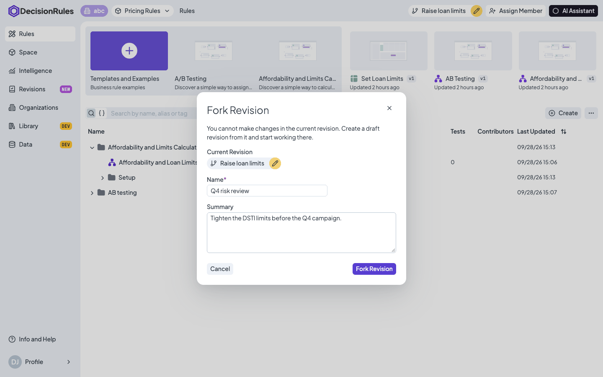
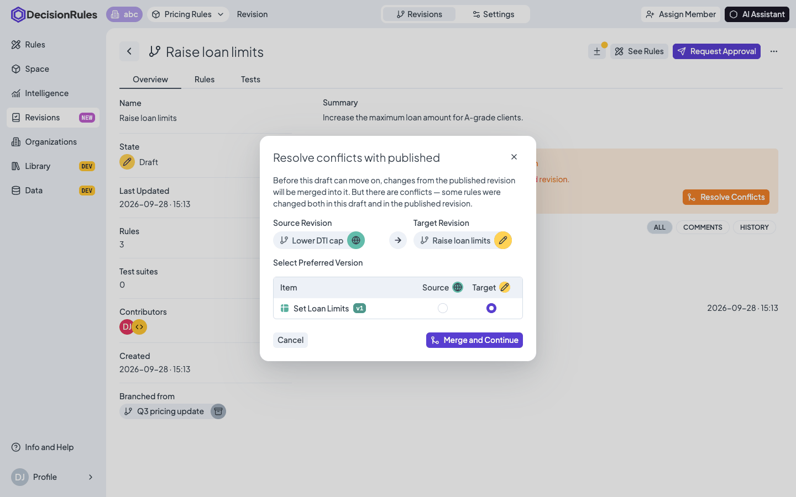
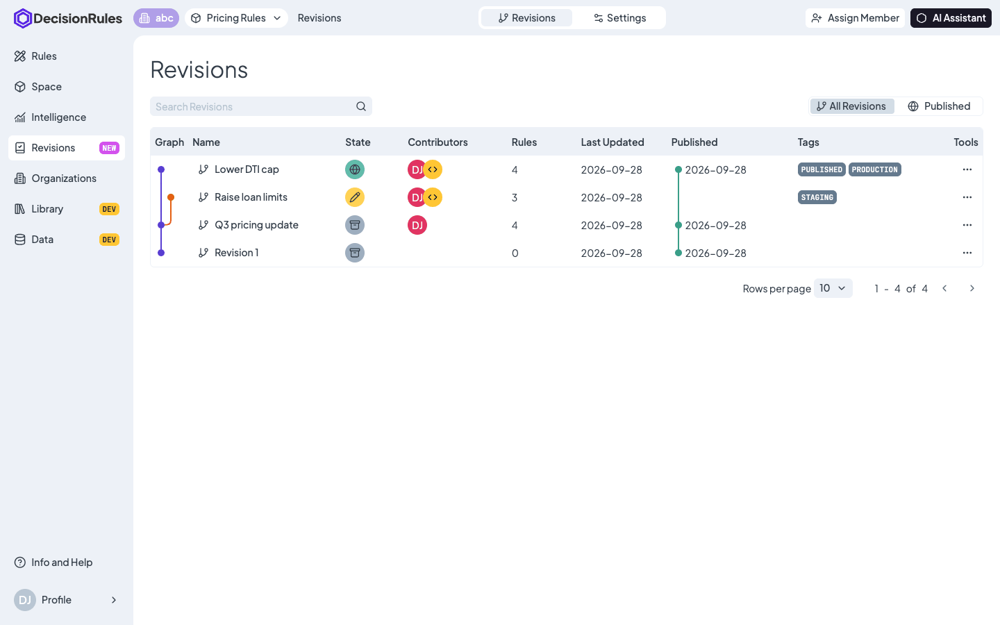
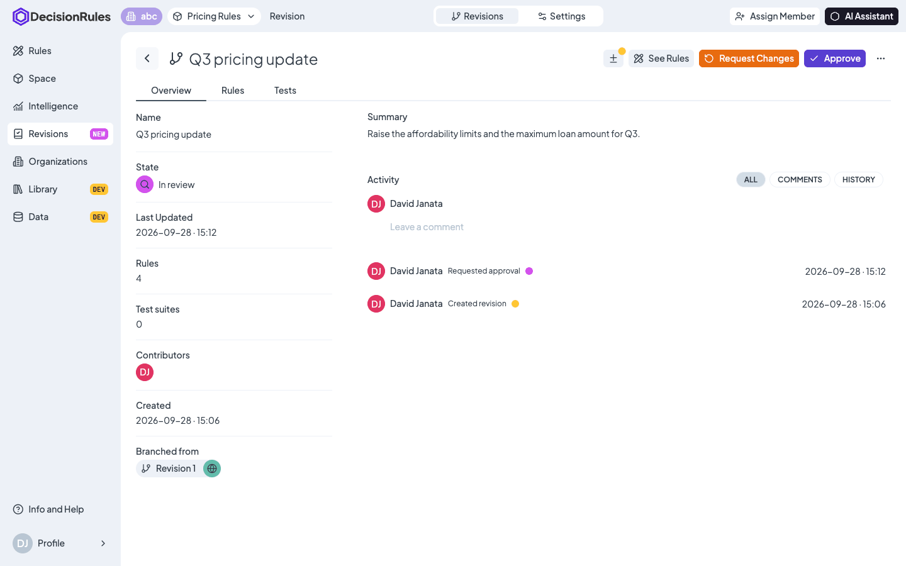

# Revisions

A revision is a snapshot of the whole space that moves through a fixed lifecycle: it is created as a draft, reviewed, published, and eventually archived. This page describes that lifecycle and the two screens of the **Revisions** section where you manage it.

### The Revision Lifecycle

* <mark style="color:$info;">Draft</mark> — accepts changes. Rules, folders and test suites are edited here.
* <mark style="color:$warning;">Awaiting approval</mark> — approval was requested. Read-only until it is approved or sent back.
* <mark style="color:$success;">Approved</mark> — ready to be published. Read-only.
* <mark style="color:purple;">Published</mark> — live. Exactly one revision is published at a time.
* Archived — closed. Either a published revision that was replaced by a newer one, or an open revision that was archived without being published. Archived revisions stay readable, comparable and callable from the API by name.

| Action                    | From                                                     | To                                             | Permission       |
| ------------------------- | -------------------------------------------------------- | ---------------------------------------------- | ---------------- |
| Fork                      | any revision                                             | a new Draft                                    | Manage Revisions |
| Request Approval          | Draft                                                    | Awaiting approval                              | Request Approval |
| Approve                   | Awaiting approval                                        | Approved                                       | Approve / Reject |
| Request Changes           | Awaiting approval, Approved                              | Draft                                          | Approve / Reject |
| Publish                   | Approved                                                 | Published — the previous one becomes Archived  | Publish          |
| Publish without Review    | Draft, Awaiting approval (the API also accepts Approved) | Published, recording the skipped steps         | Publish          |
| Force Publish             | Draft, Awaiting approval, Approved                       | Published, skipping every check                | Publish          |
| Archive                   | Draft, Awaiting approval, Approved                       | Archived                                       | Manage Revisions |
| Roll back to this version | a revision published before                              | a new Published revision with the same content | Publish          |
| Delete                    | Draft, Archived                                          | removed                                        | Manage Revisions |

The published revision itself cannot be archived or deleted; it is archived automatically when another revision is published. See [Roles and Permissions](roles-and-permissions.md) for the permissions.

### Creating a Draft

There are three ways to start a draft:

* In the revision picker in the top bar, choose **Fork Current Revision**.
* In the **Revisions** list, open the **Tools** menu of any revision and choose **Fork Revision**.
* Simply save a change while you are on a revision that is not a draft: if the space has no open draft, the UI asks you to name one and creates it from the revision you are viewing (see [Working in a Revision](working-in-a-revision.md#editing-happens-in-drafts)).

A draft starts as an exact copy of the revision it was forked from — every rule version, the folder tree and the test suites. Its changes are always measured against the _published_ revision, whichever revision it was forked from, so a draft forked from an old archived revision shows everything that differs from what is live today.

<figure><figcaption></figcaption></figure>

* Give the draft a **name** (up to 120 characters) and, optionally, a **summary** (up to 2000 characters). Names do not have to be unique, so choose descriptive ones.
* Several drafts can be open at the same time — one per feature, per team or per customer request. Two drafts that change the same rule are warned about it and reconciled when they are published (see [Conflicts with the Published Revision](revisions.md#conflicts-with-the-published-revision)).
* The new draft is checked out for you immediately.


The number of revisions an account can keep is limited — by the trial or the Space Versioning add-on in the cloud, by the licence when self-hosted — and the limit counts every revision of every space of the account, archived ones included. Delete revisions you no longer need. See [Limits, Limitations and Disabling](limits-limitations-and-disabling.md).


### Requesting Approval

When the draft is ready, open it in the **Revisions** section and click **Request Approval**, or use **Tools → Change State → Request Approval** in the list.

* The draft becomes **Awaiting approval** and stops accepting changes. Its change counts and its content are frozen exactly as the reviewer will see them.
* A draft that contains no changes compared with the published revision cannot be sent: the UI shows _"No changes in this draft — nothing to send for approval."_ and the draft stays a draft.
* If another revision was published after your draft was forked, the published changes are merged into the draft first: the UI asks you to confirm with **Update Revision** and then continues, the API merges them automatically. When the two sides conflict, **Resolve Conflicts** opens instead, and the request — in the UI and through the API — is refused with the error code `REVISION_MERGE_CONFLICTS` until the conflicts are resolved (see below).
* Catching up counts against your plan: if merging the published changes would leave the revision with more rules or tests than the plan allows, the request is refused with HTTP 426 and nothing is written — _"After catching up with the published revision, this revision would count N rules against your plan's limit of M. Delete some of them in the revision, then retry."_ The same check applies to **Update Revision**, **Resolve Conflicts** and **Publish without Review**.

### Reviewing

A reviewer with the **Approve / Reject** permission opens the revision from the **Revisions** list:

1. The **Overview** tab shows the summary the author wrote and the activity feed. The change counts are under **Compare with → Stats**.
2. **Compare with** is set to the revision the draft was forked from by default (labelled _Parent_). The **Rules** tab lists every rule; rules that are new or modified are marked, moved rules and changed folders are marked with a folder icon, and a click on a modified rule opens the side-by-side comparison. Deleted rules are listed only when **Show deleted** is switched on (**Compare with → Filters**, off by default), so switch it on before you approve. The tooltips of the marks name the revision you compare with. The **Tests** tab does the same for test suites.
3. **See Rules** checks the revision out, so the reviewer can open the rules in the designer and run the Test Bench against exactly this content.
4. The reviewer either clicks **Approve**, or clicks **Request Changes** and explains what to change. Requesting changes returns the revision to Draft; the note appears in the activity feed with a _Changes requested_ badge.

Comments can be added to any open revision (draft, awaiting approval or approved) by users with the **Comment** permission. Approved revisions can still be sent back with **Request Changes**.


The system does not prevent a user from approving a revision they wrote themselves. Separation of duties comes from the roles you assign — see [Roles and Permissions](roles-and-permissions.md#separating-authors-from-reviewers).


### Publishing

A user with the **Publish** permission opens the approved revision and clicks **Publish**, or uses **Tools → Change State → Publish** in the list. The confirmation reads _"The rules in this revision will go live and be used for Solver API calls."_

When a revision is published:

* It becomes the published revision immediately. Solver API calls that name no revision are answered from it from this moment on.
* The revision that was published before is archived. Nothing is deleted.
* Revision tags do not move by themselves. Point them at the new revision when you are ready — see [Revision Tags](revision-tags.md).
* The **Revision Archived** webhook event fires for the replaced revision and **Revision Published** for the new one. The rule changes themselves were logged in Event Logs, with their revision, when they were saved in the draft.

If another revision was published after this one was submitted for approval, it has to catch up before it can be published. When nothing conflicts, **Publish** first asks you to **Update Revision**: the published changes are merged in, the revision stays approved and the publish continues. When something conflicts, the revision shows the banner _"A newer revision was published after this one was submitted for approval"_ and **Resolve Conflicts** opens instead; you can also send it back with **Request Changes** and submit it again. Through the API such a revision cannot be published until it is brought up to date.

#### Publish without Review

**Publish without Review** (in the **⋯** menu of the revision and in **Tools → Change State**) publishes a draft or a revision awaiting approval in one step (the API also accepts an approved revision). The review steps it skips are recorded in the activity feed with a _Skipped review_ badge, and the same checks apply as on the manual path: a draft with no changes is refused with _"No changes in this draft — nothing to publish."_, and a revision that fell behind the published one is first brought up to date — with **Update Revision** when nothing conflicts, with **Resolve Conflicts** otherwise.

#### Force Publish

**Force Publish** makes the revision's content live exactly as it is, skipping review and every conflict check. Anything that was published since the revision was forked is overwritten by it. The confirmation says so and the activity feed marks the entry _Force published_. Use it only when you need to bypass the process on purpose, for example to push an emergency fix from an old draft.

### Conflicts with the Published Revision

A draft is _out of date_ when another revision was published after the draft was forked. That is normal when several drafts are open, and most of the time it is harmless: the published changes are merged into the draft when it is updated, so the reviewer sees the draft on top of what is live.

A _conflict_ is a rule version, the folder structure or a test suite that changed differently on both sides. Conflicts cannot be merged automatically, so you decide each one:

* When nothing conflicts, the revision's detail page shows **Published Changes Available** with an **Update Revision** button, and **Request Approval**, **Publish** and **Publish without Review** ask you to **Update Revision** first: the published changes are merged in and the action continues. An approved revision stays approved.
* When something conflicts, the detail page shows the banner _"This revision has conflicts with the published revision"_ (or, on a revision awaiting approval or approved, _"A newer revision was published after this one was submitted for approval"_) with a **Resolve Conflicts** button, and the same actions open **Resolve Conflicts** instead. **Request Approval** — in the UI and through the API (`request-approval`) — is refused with `REVISION_MERGE_CONFLICTS` while conflicts remain.
* The **Resolve Conflicts** dialog (you need the permission to update rules) shows the **Source Revision** (the published one) and the **Target Revision** (this revision). Under **Select Preferred Version** it has one row for every conflicting rule version, one for the folder structure and one for each conflicting test suite. Each row offers **Undetermined**, **Source** and **Target**, and every row starts as **Undetermined**. Clicking a rule opens the side-by-side comparison of the two versions and keeps your pick.
* Click **Merge and Continue** — it stays disabled until every row has **Source** or **Target** picked. The picks are applied, all other published changes are pulled into the draft, and the draft is up to date with the published revision. From here on its changes are measured against that revision. Like **Update Revision**, the merge is refused with HTTP 426 when it would leave the revision over a plan limit (see [Requesting Approval](revisions.md#requesting-approval)).

<figure><figcaption></figcaption></figure>

Updating or resolving a revision that is **awaiting approval** or **approved** does not change its state, so an approved revision can be caught up and then published.


Rules and test suites that only the published side changed are pulled in without asking. Folder changes merge automatically unless both sides reorganized folders; then you keep one side's whole folder tree. Each conflicting test suite is resolved on its own.


The UI also warns you _before_ a conflict exists: the first time you edit a rule that another open revision has already changed, the **Potential Conflict** dialog offers to continue in that revision instead. See [Working in a Revision](working-in-a-revision.md#editing-a-rule-that-another-draft-also-changed).

### Rolling Back

To make a previous release live again, open **Tools → Roll back to this version** on any revision that was published before (it is offered only on revisions that are not the current published one). The confirmation explains what happens: _"This publishes a copy of the selected revision as the new live version — a newer revision than the one currently published. Nothing is lost: the current published revision is archived and stays in the history."_

The rollback creates a new revision named _Rollback to \<name>_ with the selected revision's content and publishes it immediately. The history stays append-only: the revision you rolled back from is archived and can itself be rolled back to later. Because a rollback publishes, it needs the **Publish** permission.

The new revision carries a **Rollback** badge next to its state in the **Revisions** list — its tooltip names the revision it restored — and in its activity feed, and its **Overview** shows **Rolled back to** with the revision whose content it restored.

### Archiving and Deleting

* **Archive** closes a draft, a revision awaiting approval or an approved revision without publishing it. The content is kept; the revision can still be compared, forked or called from the API by name.
* **Delete** removes a draft or an archived revision permanently, together with its comments and activity. It is refused while a revision tag points at the revision, and for an archived revision that open revisions still measure their changes against (it was the published revision when they were created) — publish, archive or delete those revisions, or bring them up to date with the current published revision, first. Deleting frees the account's revision quota.

### The Revisions List

The **Revisions** section lists every revision of the space, newest first. Its header has a **Revision Settings** button that opens **Space → Settings**, tab **Revision Settings**.

<figure><figcaption></figcaption></figure>

* **Graph** draws the fork lineage: a fork's line joins the revision it was created from.
* **Name**, **State** (hover the icon for the state name), **Contributors** (everyone who saved something in the revision — API keys are shown with a code icon), **Rules** (number of rule versions), **Last Updated**, **Published** (the date a revision went live, for every revision that was ever published) and **Tags** (the revision tags pointing at it).
* **Search Revisions** filters by name; the **All Revisions / Published** switch limits the list to the revisions that were ever published, in the order they went live.
* Click a row to open the revision. Right-click a row, or open its **Tools** menu, for **Fork Revision**, **Tag Revision** (move one of the space's tags here; **PUBLISHED** is never offered, and the menu shows _No tags yet_ when the space has no other tag), **Roll back to this version**, **Change State** (**Request Approval**, **Approve**, **Request Changes**, **Publish**, **Publish without Review**, **Force Publish**, **Archive** — whichever apply to the revision's state) and **Delete Revision**.

### The Revision Detail

Opening a revision shows its detail page with three tabs.

<figure><figcaption></figcaption></figure>

* The header holds **Compare with** (the diff icon: the revision to compare with, which starts at the parent revision; **Filters → Show deleted**; and **Stats** with the new, modified, deleted and moved rules, tests and folders), **See Rules** (checks the revision out and opens the rule list) and the lifecycle buttons that apply to the revision's state: **Request Approval**, **Approve**, **Request Changes**, **Publish**, and a **⋯** menu with **Publish without Review** and **Force Publish** (for users with the **Publish** permission) and **Archive** (for users with **Manage Revisions**).
* **Overview** shows the name (click to rename), state, **Tags** (the tags pointing at the revision, **PUBLISHED** included), last update, rule and test-suite counts (test suites only for users who may view tests), contributors, creation time and **Branched from** (the revision it was forked from, click to open it) or **Rolled back to**, the **Summary** (click to edit) and the **Activity** feed. The feed combines the history of the revision (_Created revision_, _Requested approval_, _Approved this revision_, _Published this revision_, …) with the comments; filter it with **All**, **Comments** or **History**. A revision can hold up to 100 comments of up to 2000 characters each.
* **Rules** is a read-only rule list of the revision. While comparing, new and modified rules, moved rules and changed folders are marked (deleted rules with **Show deleted** on); a click on a modified rule opens the comparison.
* **Tests** is the read-only test-suite list of the revision, marked the same way.

The name and summary can be edited only while the revision is a draft or awaiting approval, by users with **Manage Revisions**.

When the revision a revision was forked from (or rolled back to) has been deleted, **Branched from** shows its name with the tooltip _Deleted revision_ and cannot be opened, and the detail opens without a comparison. A link to a revision that no longer exists shows _Revision not found_ with **Back to revisions**.
