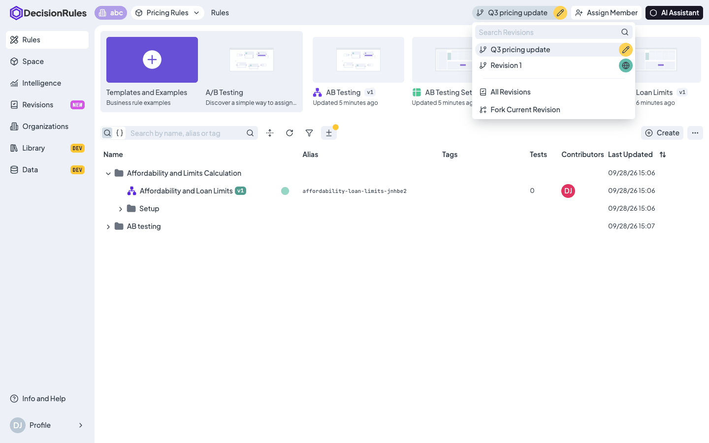
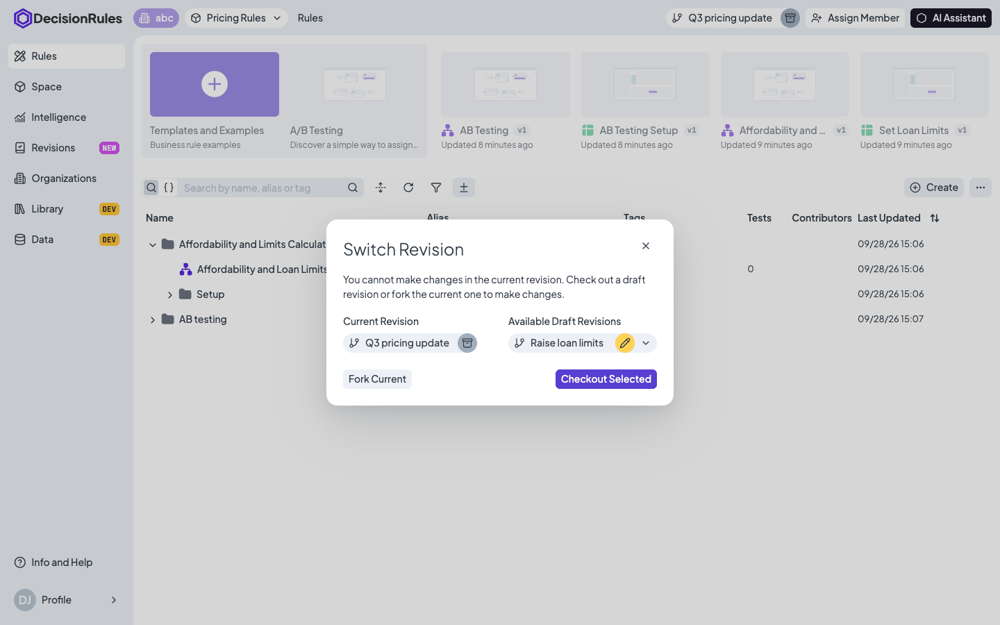
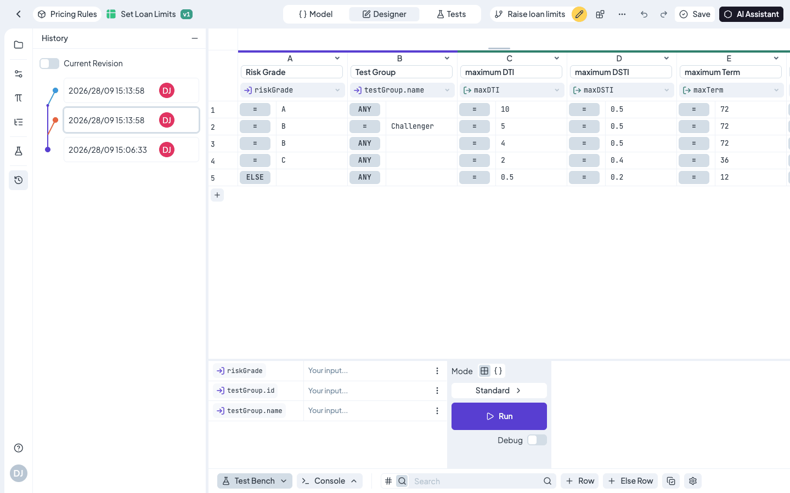
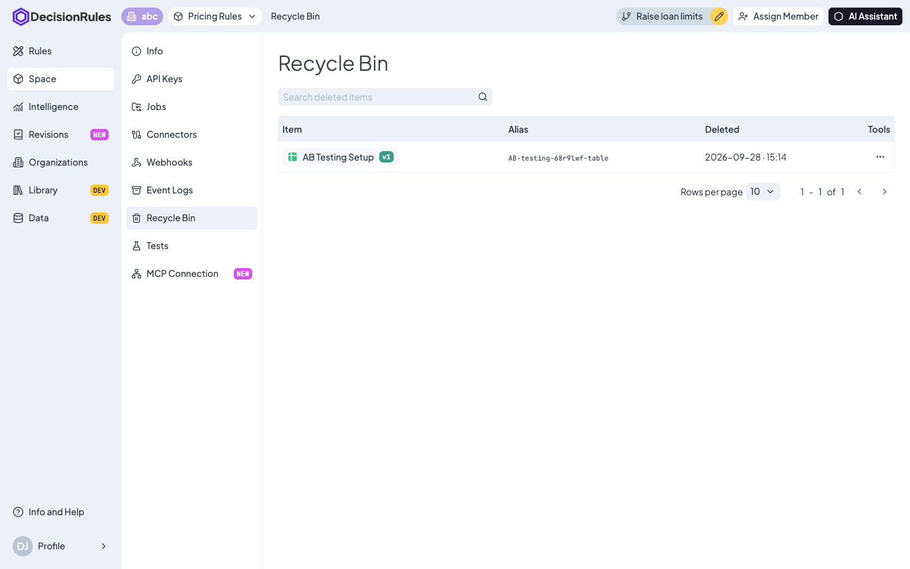

# Working in a Revision

On a versioned space, everything you see and change in the UI belongs to one revision — the revision you have _checked out_. This page describes what that means for the rule list, the rule editor, tests, history and the other parts of the UI.

### The Revision Picker

The revision picker sits in the top bar of the rule list, the rule editor, the Tests page and the Recycle Bin. It shows the name and state of the revision you are on.

<figure><figcaption></figcaption></figure>

Click it to switch:

* The list shows the open drafts first, then the revisions awaiting approval and the approved ones, the published revision, and the most recently archived revisions. Use the search field to find older archived revisions by name.
* **All Revisions** opens the [Revisions](revisions.md) section.
* **Fork Current Revision** creates a new draft from the revision you are on and checks it out (needs the **Manage Revisions** permission).

How the checkout behaves:

* A versioned space always has a revision checked out. The first time you open the space — and right after Space Versioning is enabled — the published revision is checked out for you.
* The revision you are viewing is part of the page URL as `?revisionIdentifier=`; the parameter is omitted for the published revision. A URL may also name a revision tag or `PUBLISHED`. A reload, a bookmark or a shared link reopens the same revision. A link without the parameter, or one naming a revision that no longer exists, opens the published revision.
* Links you open in a new tab keep the revision you are viewing: **Open in new tab** and a middle-click in the rule list, and the rule links in Tests, Test Runs, Event Logs, the audit logs, Decision Flow nodes, Jobs and connectors.
* The browser does not remember a checkout on its own: each user and each tab is on the revision its URL names. The browser's back and forward buttons return to the revision a page was left at.
* If the revision you had checked out is deleted, you are moved back to the published revision.
* Every request the UI makes carries your checkout, so the rule list, folders, tests, history and the Recycle Bin always show the same revision.

When you switch with a rule open, the UI first leaves the rule. Unsaved changes prompt you to **Save** (into the revision you are leaving), **Discard** or **Cancel** the switch. The same rule then opens in the new revision; if it does not exist there, you are taken back to the rule list and the **Rule Unavailable in This Revision** dialog says _"The selected revision does not contain the rule or rule version you were viewing. You have been returned to the rule list."_ Close it with **I Understand**.

### Editing Happens in Drafts

Only a draft accepts changes. Saving a rule, changing a folder, editing a test suite or a test, editing rule tags or restoring a version from history while you are on a published, archived or approved revision, or one awaiting approval, does not save. Instead, the UI opens one of two prompts:

* **Switch Revision** — when the space has open drafts that can take the change. It says _"You cannot make changes in the current revision. Switch to a draft revision or fork the current one to make changes."_, lets you pick one of the drafts and offers **Switch to Selected** or **Fork Current**. For a change to a specific rule version, only the drafts that still contain that rule version are offered; when none does, the Fork Revision prompt below opens instead. **Switch to Selected** saves the content of your editor into the chosen draft, replacing that draft's copy of the rule version.
* **Fork Revision** (or **Name your revision**) — when there is no draft that can take the change. Name the new draft, optionally describe it, and click **Fork Revision**. The draft is created from the revision you were viewing, checked out, and your save goes through in it.

After either choice, the save you started goes through in that draft. A folder change (moving, renaming or deleting folders and rules) is the exception: it is repeated in the draft only when the draft has the same folder tree as the revision you were viewing — a draft you have just forked always has — or when it deletes only rules that all exist in the draft. Otherwise nothing is changed and the UI says _"Switched to the draft, but its folder structure differs from the revision you were viewing. Nothing was changed. Check the folder tree and repeat the action."_ (for a rule delete: _"Switched to the draft, but it does not contain all of the selected rules. Nothing was deleted."_). Check the folder tree of the draft and repeat the action there.

<figure><figcaption></figcaption></figure>

Running rules and tests is never blocked: the Test Bench, test suites and Jobs run against whatever revision you have checked out. On a revision that is not a draft, the Test Bench's **Run** does not save first (its tooltip changes from _Save and run solve_ to _Run solve_).


The naming dialog suggests a name — for a fork, the source name with a number added (_Q3 pricing 2_); otherwise a random two-word name (_Brave Fox_). Change it to something your reviewers will recognize. The **Summary** is shown on the revision's detail page.


#### Editing a rule that another draft also changed

Several revisions can be open at once. When you make your first change to a rule that another open revision — another draft, a revision awaiting approval or approved, or the published revision — has already changed since the two branched, the UI warns you with the **Potential Conflict** dialog: _"This rule has been changed in another revision that has a common ancestor with the current one. If you edit it here, you will create a potential merge conflict. How do you wish to proceed?"_ Choose **Switch to Edited Revision** to continue in the other revision (only a draft can be chosen), or **Edit Here Anyway** to keep working in yours. The warning is shown once per rule and checkout. How conflicts are resolved later is described in [Revisions](revisions.md#conflicts-with-the-published-revision).

### Rule List and Folders

The rule list shows the rules and folders of the checked-out revision. On a versioned space it gains a **Compare with** button (the diff icon) next to the filter button. Its menu holds the revision to compare with, **Filters → Show deleted** and **Stats**:

* **Compare with** picks a revision to compare against. A draft, a revision awaiting approval or an approved revision compares against the revision it was branched from by default (marked **PARENT** in the list); a published or archived revision starts with **No comparison**. Your choice is remembered for that revision while the tab is open.
* While comparing, every rule that differs gets a dot. Its tooltip names the compared revision: <mark style="color:$success;">Only in this revision, not in …</mark>, <mark style="color:$warning;">Differs from … — click to compare</mark>, which opens the two versions side by side, and, when **Show deleted** is on, <mark style="color:$danger;">Not in this revision, only in …</mark> for the rows listed at the bottom.
* Rules and folders that sit in a different folder than in the compared revision get a folder icon whose tooltip says where they were, for example _In Pricing/Archive in Q3 pricing update_ or _In the root folder in Q3 pricing update_. A renamed folder shows its earlier name, for example _Named “Limits” in Q3 pricing update_.
* **Show changes only** narrows the list to what changed.
* The **Stats** section counts **Rule Changes**, **Test Changes** and **Folder Changes** — new, modified, deleted and moved items. A **Contributors** column shows who changed each rule.

<figure><figcaption></figcaption></figure>

The comparison screen also lets you pick a rule and two revisions — **First Revision** and **Second Revision** — and see the same rule as it is in each of them. A comparison has the tabs **Designer**, **Model** and **Settings**. The **Designer** comparison exists for Decision Tables and Scripting Rules; other rule types show _"Visual comparison is not available for this rule type yet."_ there. **Model** and **Settings** compare any rule type. See [Rule Comparison](../../rules/common-rule-features/rule-comparison/).

Folders belong to the revision too: moving a rule into another folder in a draft does not move it in the published revision until the draft is published.

### Rule History

[Rule History](../../rules/common-rule-features/rule-history.md) keeps working as before — every save creates an entry — and on a versioned space it also shows which revision each save was made in:

* The graph on the left draws one lane per revision, with a diagonal where a revision was forked. Hover a dot to see the revisions of that lane.
* The **Current Revision** switch (on by default) reduces the list to the saves that belong to your checked-out revision — its own saves and the saves it inherited. Switch it off to see the saves made in every revision.
* **Restore version** writes the selected save into your checked-out draft. If you are not on a draft, the Switch Revision or Fork prompt appears first.
* **Compare with current** and **Clone version** work as on any space.

<figure><figcaption>
Rule History with one lane per revision
</figcaption></figure>


Disabling Space Versioning keeps the history of every save that was made in a revision that was published at some point. Saves made only in drafts that were never published are removed with the drafts.

Deleting a rule keeps its history. Deleting the space deletes its revisions, its tags and the history of its rules.


### Tests and Test Runs

* The **Tests** tab lists the test suites of the checked-out revision and reloads when you switch. Creating and editing tests and suites needs a draft, exactly like rules.
* The same **Compare with** control is available above the tests; it counts **Test Changes** and marks suites and tests as new, modified or deleted. With **Show deleted** on, deleted suites and tests are listed read-only.
* Tests can be run on any revision. A test run records the revision it ran against when it started, and the **Test Runs** table gets a **Revision** column. A run made against a revision that no longer exists shows _Deleted revision_. A test run started through the API must name its revision with `?revisionIdentifier=` — see [API and Integrations](api-and-integrations.md).
* The test suites of a specific revision can also be browsed read-only on the revision's detail page, in its **Tests** tab.

### Recycle Bin

**Space → Recycle Bin** lists the rules that were deleted in the checked-out revision. It is shown only on versioned spaces.

<figure><figcaption></figcaption></figure>

* Each row shows the rule and its version, the alias, and when and by whom it was deleted — hover the avatar in the **Deleted** column to see the user.
* **Export** downloads the deleted rule as JSON (needs the rule export and history permissions).
* **Restore** and **Restore with New Alias** bring the rule back into the revision you are on. They are available only while you are on a draft and have the **Create Rule** permission; a restored rule counts against the plan's rule limit like a newly created one. After a restore, the rule list and folders refresh and the toast _"Rule restored into the draft."_ is shown. Use **Restore with New Alias** when another rule has taken the alias in the meantime.
* Switching revisions in the picker switches the bin: a rule deleted in draft A is not listed in draft B or in the published revision.

### Jobs

A [Job](../jobs.md) started from the UI runs against your checked-out revision; a job started through the API runs against the revision named in the request, or the published revision. The Jobs table shows the revision in a **Revision** column.

### Teamwork

[Teamwork](../../rules/common-rule-features/teamwork.md) presence is shown per revision:

* In the _Currently viewing_ popover, a user who has a different revision checked out gets a badge with that revision's name. Their unsaved changes are not previewed.
* In the rule list, the avatar of a colleague who works on a rule in another revision is labelled with that revision's name, or _another revision_.
* Live cell highlights, unsaved-change markers, the _Remote unsaved changes_ warning before a save and the _Rule was saved by another user_ notification only concern users working in the same revision as you. Two people editing the same rule in two different drafts do not interfere with each other.

### Event Logs and Audit Logs

Event Logs and the Decision Intelligence audit logs record the revision of every event and of every solve made through the Solver API. On a versioned space both offer a **Revision** filter and column, and the revision lifecycle events (created, approval requested, published, …) appear in Event Logs next to the rule events. Service Logs list HTTP requests without a revision. Solves sent through Kafka always use the published revision, and their audit records carry no revision. See [Event Logs](../event-logs-service-logs-and-notifications.md).

### Integration Samples

The **Integrations** panel of a rule generates its samples for the revision you have checked out. All **Code Samples** — cURL, JavaScript, Python, PHP, .NET and Java — are plain HTTP calls: on a revision other than the published one, the solver URL carries `?revisionIdentifier=` with a tag that points at the revision, or with the revision ID. The **Swagger** tab adds the same `revisionIdentifier` parameter on a versioned space. For an Integration Flow on a versioned space, the job-start sample always names a revision — `PUBLISHED` when you are on the published revision. See [API and Integrations](api-and-integrations.md).
